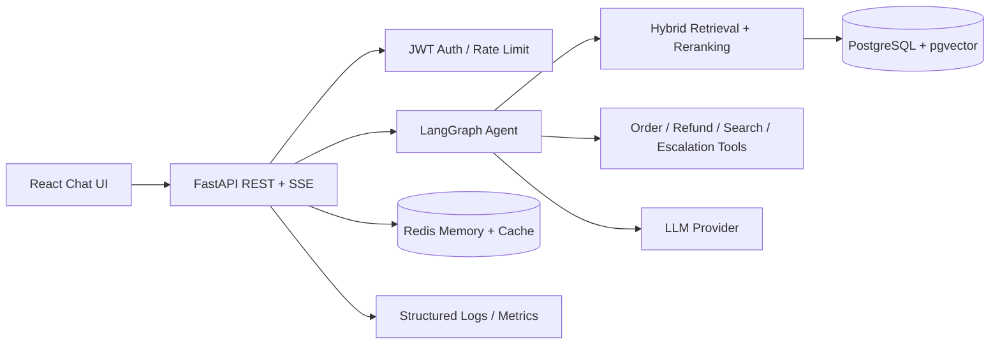

# Enterprise AI Agent Architecture

## Multimodal PDF ingestion

- Upload parses PDFs page by page with pdfplumber: prose text and line-bordered tables become separate segments, and every ingested chunk carries its `page_number` and `kind` (`text` or `table`) in metadata.
- pypdfium2 renders each page (capped by `MAX_RENDER_PAGES`) to `PAGE_IMAGE_DIR/<document_id>/page-<n>.png`.
- Citations produced by the generator include filename, page number, kind and a `page_image_url`; `GET /api/documents/{id}/pages/{n}/image` serves the rendered page to the document owner so any cited answer can be checked against the original page.
- Both parsing libraries are permissively licensed (MIT / BSD-3-Clause) and run offline; no external OCR or vision API is used.

## Reliability and safety

- Retrieval responses retain source-document citations.
- Tool access is separated from free-form generation.
- Authentication and rate limiting protect application endpoints.
- External model calls remain observable through latency, token, and cost metrics.
- Evaluation covers faithfulness, relevance, recall, precision, latency, and cost.
